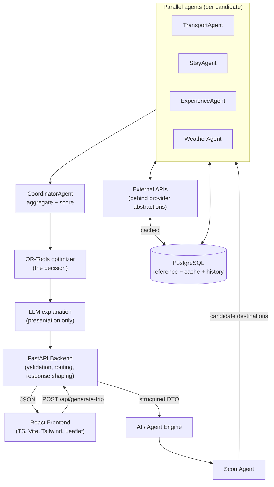
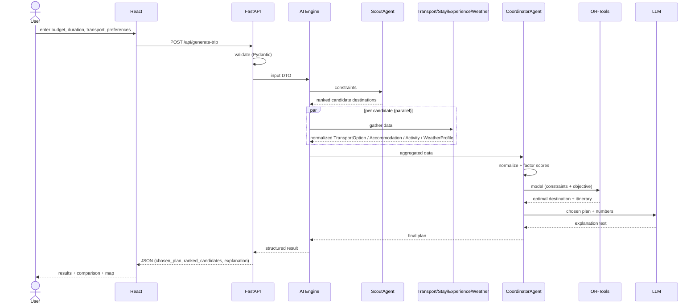
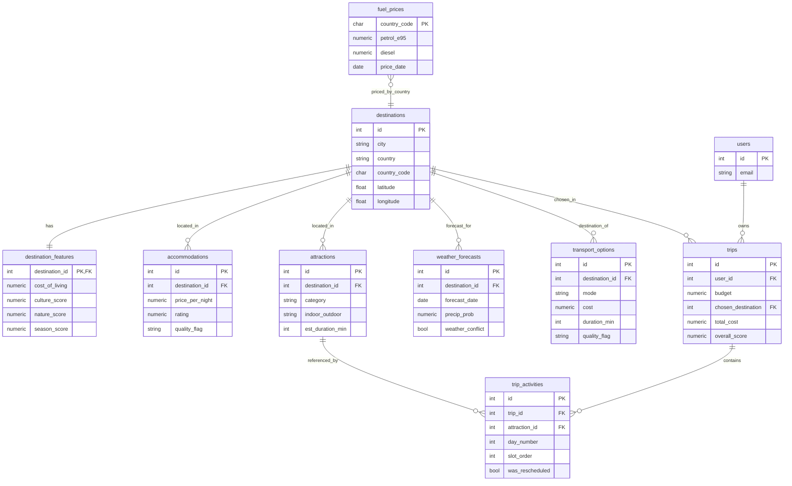
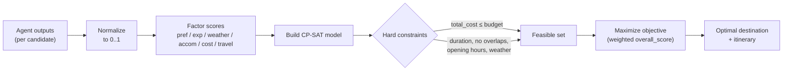
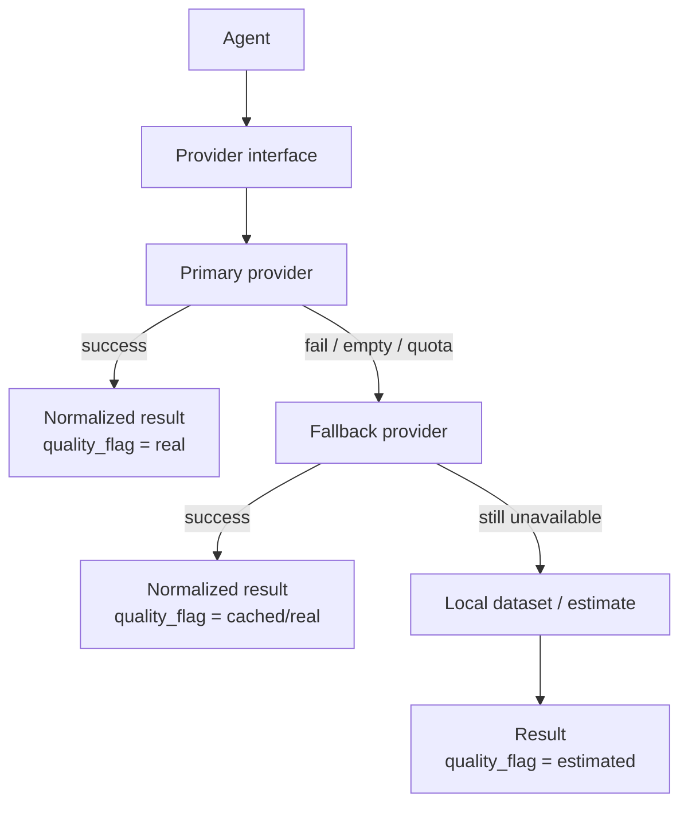
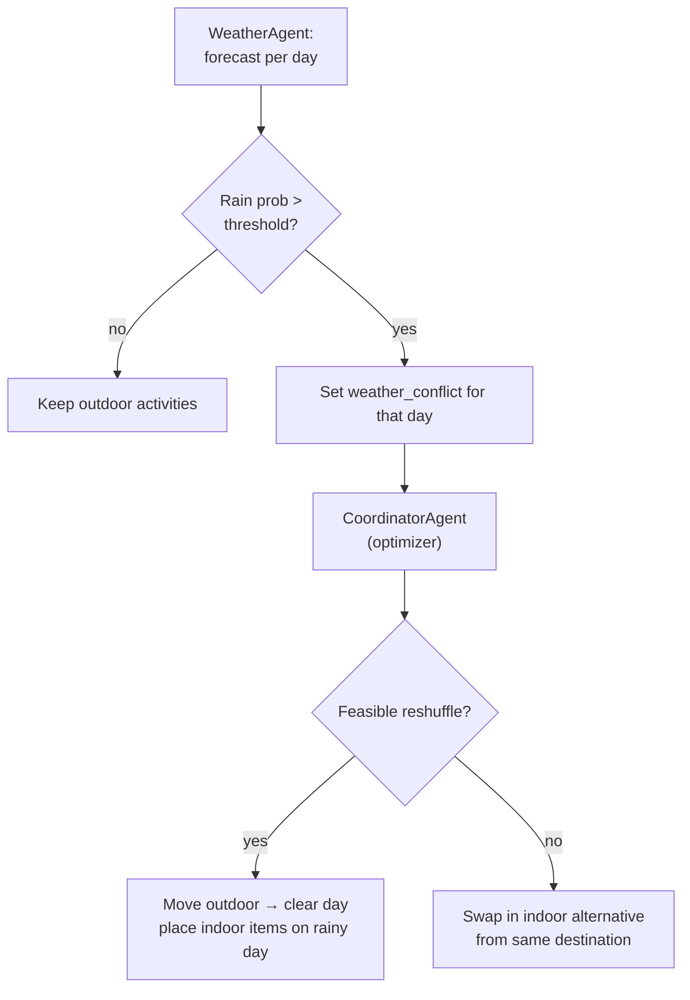

# BudgetSwarm — Diagrams (Mermaid)

These render directly in GitHub/GitLab and most Markdown viewers, and can be exported as images for the thesis (e.g. via the Mermaid Live Editor at mermaid.live). They restate the ASCII diagrams from the technical documentation in a cleaner, exportable form.

---

## 1. High-level architecture

---

## 2. End-to-end data flow (sequence)

---

## 3. Database ER diagram

---

## 4. Optimization pipeline

---

## 5. Provider abstraction & fallback chain

---

## 6. Weather-aware replanning (hybrid rules + optimization)

